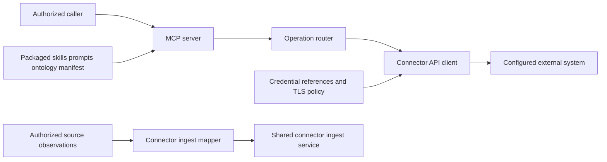

# Connector architecture

The `immich-api` package owns external-system operations and source mappings.
The [shared connector SDK](https://github.com/Knuckles-Team/agent-connector-sdk/blob/5babc4cc48ad73928468b243842f219f51e2cca1/README.md) owns reusable runtime contracts.

## Source and verification map

| Boundary | Source | Verification target |
|---|---|---|
| MCP entry and routing | `immich_api/mcp_server.py`, `immich_api/mcp/mcp_system.py` | `tests/test_immich_mcp_validation.py` |
| Credentials and TLS | `immich_api/auth.py` | `tests/test_auth.py` |
| External requests | `immich_api/api/api_client_base.py` | `tests/test_api_wrapper.py` |
| Native content and tool schemas | Package content and `scripts/generate_tool_schemas.py` | Live schema check; native content verification remains pending |
| Source observations | `immich_api/kg_ingest.py` | `tests/test_kg_ingest.py` |

The [capability specification](https://github.com/Knuckles-Team/immich-api/blob/main/specs/immich-api/spec.md)
defines the planned behavior and acceptance targets.
The [delivery dashboard](https://knuckles-team.github.io/immich-api/spec-delivery/)
shows source-backed records, code mappings, and declared relationships.
Its architecture download preserves the declared spec graph without inferring dependencies from shared code.

The generated source does not prove live service behavior, published artifacts, or deployed operation.
