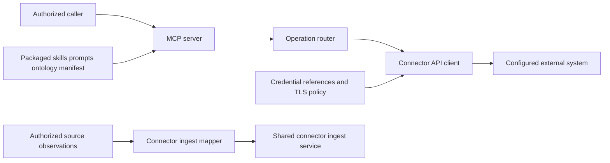

# CONN-IMMICH-API — Design and implementation plan

Governing specification: [spec.md](spec.md).

## Existing system and reuse

The connector reuses the SDK server factory, credential resolver, HTTP client, and typed ingest service.
The connector owns operation arguments, external-system mappings, and package content.

Ownership, component identity, SDK reference and implementation inventory are
recorded in [the governing scope](spec.md#scope-and-owner).

## Architecture

## Interfaces and live integration path

`immich_api/mcp_server.py` exposes `build_server` and the console entry point.
`get_mcp_instance` calls `create_mcp_server`, `register_tool_surface`, and the package tool registrars.
`immich_api/mcp/__init__.py` registers `OpenApiTool` domains from `openapi_runtime.py`; each operation uses `get_client` to obtain `ApiClientSystem(OpenApiClient)`. The bounded album sample registrar calls the same declared-operation client.
`immich_api/auth.py` resolves references only when a caller requests a client.
`immich_api/openapi_runtime.py` enforces transport and response limits before returning external data.
`immich_api/kg_ingest.py` maps observations into SDK types and calls the configured service's `submit` method.
The SDK owns engine transport and durable checkpoints.

## Content and contracts

The server serves package prompts, skills, ontology, and `connector_manifest.yml` through native MCP primitives.
The schema generator reads `tools/list` without invoking vendor operations.
It records both input and output schemas. Empty source presets declare no extraction integration.
`tests/test_immich_content.py` exercises production native content discovery and prompt rendering. The extraction preset is disabled pending an SDK-supported provider/account stream binding; no default source mode is claimed.

## Dependencies and decisions

The pinned SDK and the immutable OpenAPI contract govern runtime dispatch and content. Source mapping/graph acceptance remains pending; no ingestion preset is enabled.
The SDK reference records a source dependency; it does not create a cross-repository delivery prerequisite.
Reviewers must add `Depends-on:` declarations only for confirmed prerequisite requirements.
Each source mapping must match the connector's actual external data before ingestion is enabled.

## Quality and release gates

Run `python scripts/check_connector_contract.py . --package immich_api`.
Run `python scripts/generate_tool_schemas.py --check` and `python -m pytest tests -q`.
Run the pinned pre-commit and pre-push gates with the approved scanner toolchain.
The published site must pass the shared readiness checks and render canonical spec records.
Source tests do not authorize release, deployment, or external effects.

## Risks and alternatives

Declared operations and mappings require authenticated external-system validation before production use.
Missing credentials, rejected source observations, and failed transport checks must propagate as explicit failures.
Duplicating shared SDK or pipeline logic would create conflicting owners.
