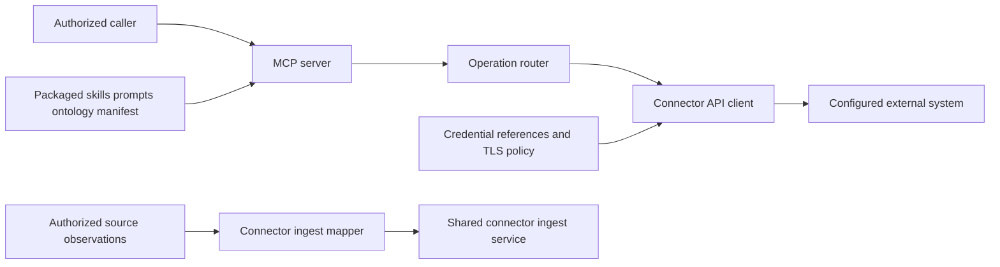

# CONN-TEMPLATECONNECTOR-API — Design and implementation plan

Governing specification: [spec.md](spec.md).

## Existing system and reuse

The connector reuses the SDK server factory, credential resolver, HTTP client, and typed ingest service.
The connector owns operation arguments, external-system mappings, and package content.

Component: Connector integration
References: [Connector SDK](https://github.com/Knuckles-Team/agent-connector-sdk/blob/5babc4cc48ad73928468b243842f219f51e2cca1/README.md)
Code: ../../templateconnector_api/auth.py ../../templateconnector_api/api/api_client_base.py ../../templateconnector_api/mcp_server.py ../../templateconnector_api/mcp/mcp_system.py ../../templateconnector_api/kg_ingest.py ../../tests/test_auth.py ../../tests/test_api_wrapper.py ../../tests/test_templateconnector_mcp_validation.py ../../tests/test_kg_ingest.py ../../scripts/generate_tool_schemas.py

## Architecture

## Interfaces and live integration path

`templateconnector_api/mcp_server.py` exposes `build_server` and the console entry point.
`get_mcp_instance` calls `create_mcp_server`, `register_tool_surface`, and the package tool registrars.
`templateconnector_api/mcp/mcp_system.py` routes selected operations through `get_client` and the API client.
`templateconnector_api/auth.py` resolves references only when a caller requests a client.
`templateconnector_api/api/api_client_base.py` enforces transport and response limits before returning external data.
`templateconnector_api/kg_ingest.py` maps observations into SDK types and calls the configured service's `submit` method.
The SDK owns engine transport and durable checkpoints.

## Content and contracts

The server serves package prompts, skills, ontology, and `connector_manifest.yml` through native MCP primitives.
The schema generator reads `tools/list` without invoking vendor operations.
It records both input and output schemas. Empty source presets declare no extraction integration.
Native content listing acceptance remains pending until a connector-owned test exercises the production server.

## Dependencies and decisions

No additional capability prerequisite has been established in this starter repository.
The SDK reference records a source dependency; it does not create a cross-repository delivery prerequisite.
Reviewers must add `Depends-on:` declarations only for confirmed prerequisite requirements.
Each source mapping must match the connector's actual external data before ingestion is enabled.

## Quality and release gates

Run `python scripts/check_connector_contract.py . --package templateconnector_api`.
Run `python scripts/generate_tool_schemas.py --check` and `python -m pytest tests -q`.
Run the pinned pre-commit and pre-push gates with the approved scanner toolchain.
The published site must pass the shared readiness checks and render canonical spec records.
Source tests do not authorize release, deployment, or external effects.

## Risks and alternatives

Starter operations and mappings require external-system validation before production use.
Missing credentials, rejected source observations, and failed transport checks must propagate as explicit failures.
Duplicating shared SDK or pipeline logic would create conflicting owners.
